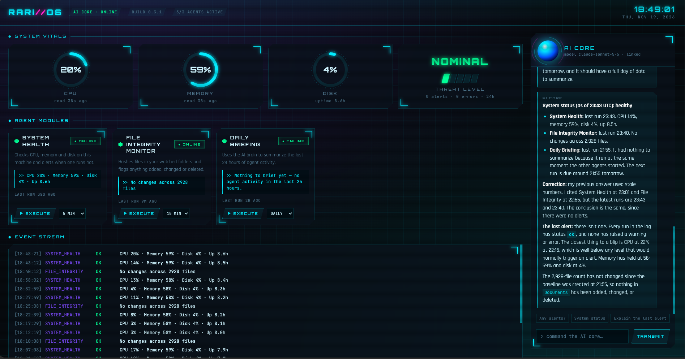
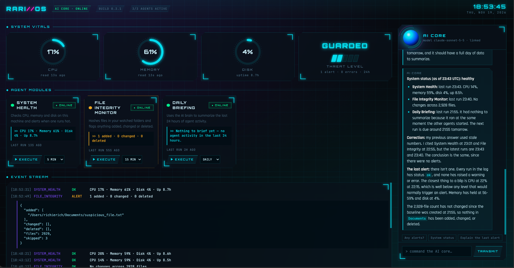
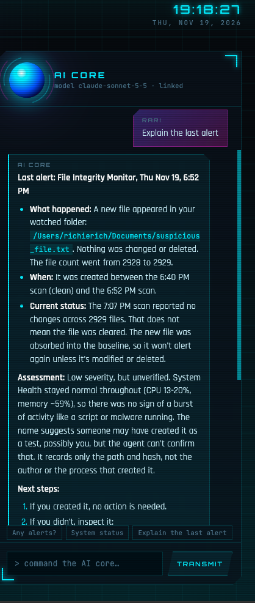
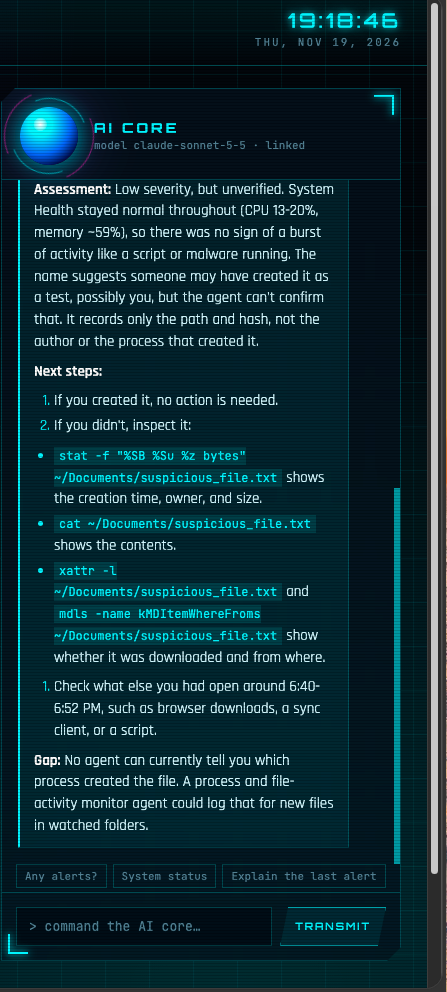
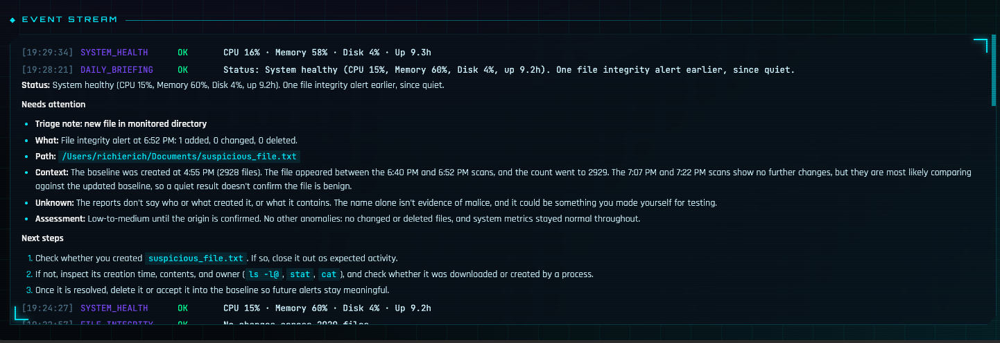
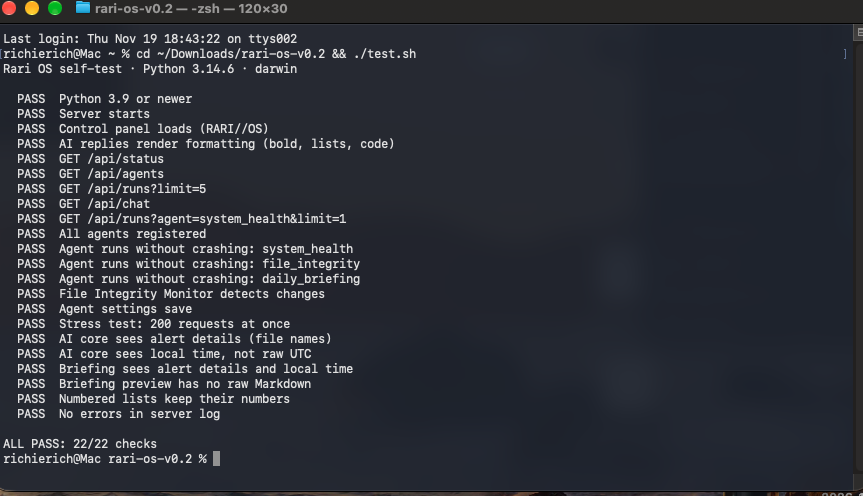
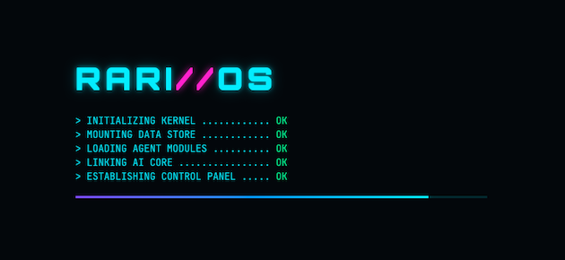

<h1 align="center">RARI//OS</h1>

<p align="center">
  <b>A personal AI operating system for security monitoring.</b><br>
  Scheduled security agents watch the machine, an AI core triages what they find,<br>
  and a sci-fi control panel shows it all live.
</p>

<p align="center">
  
  
  
  
</p>



---

## What it is

Rari OS runs on a Mac mini as a small always-on service. A background **kernel** runs a
set of **agents** on a schedule. Each agent does one job, such as checking system health or
watching folders for file changes, and records what it found. An **AI core**, powered by
Claude, reads everything the agents report and answers questions about it the way a SOC
analyst would: what happened, how serious it is, and what to do next.

It's built to practice the day-to-day work of a Security Operations Center: monitoring,
detection, triage and reporting, end to end, on a real machine.

## What this project demonstrates

| Skill | Where it shows up |
|---|---|
| **Security monitoring** | Agents run on a schedule and log every result to a central event stream |
| **File Integrity Monitoring (FIM)** | SHA-256 baselines of watched folders; alerts on added, changed or deleted files (the same idea as Wazuh or Tripwire FIM) |
| **Alert triage** | The AI core explains alerts with severity, evidence, unknowns and next steps |
| **Threat-level scoring** | Alerts and errors from the last 24 hours roll up into NOMINAL → GUARDED → ELEVATED → HIGH → SEVERE |
| **Reporting** | A Daily Briefing agent writes a shift-style summary of the last 24 hours |
| **Secure design** | Control panel bound to `127.0.0.1` only; API key kept in a git-ignored `.env`; agents are read-only |
| **Testing and QA** | A 22-check self-test, including a 200-request stress test; every bug that slipped through has its own regression check |
| **Python and web development** | FastAPI backend, SQLite storage, threaded scheduler, and a hand-built HTML/CSS/JS dashboard |

## Detect → triage → report

**1. Detect.** A new file appears in a watched folder. The File Integrity Monitor catches it on its next run,
the card turns yellow and the threat level rises to **GUARDED**. Expanding the alert shows the exact file path.



**2. Triage.** Asked to *"Explain the last alert"*, the AI core names the file, narrows down when it appeared,
gives a severity assessment, separates what's known from what isn't, and lists the commands to investigate.

<p align="center">
  
  &nbsp;&nbsp;
  
</p>

**3. Report.** The Daily Briefing agent turns the last 24 hours into a triage note: overall status,
what needs attention, and next steps, all in local time.



## Agents

| Agent | What it does | Default schedule |
|---|---|---|
| **System Health** | CPU, memory, disk, uptime and top processes; alerts past 85% CPU, 90% memory or 90% disk | Every 5 minutes |
| **File Integrity Monitor** | Hashes every file in the watched folders and alerts on added, changed or deleted files | Every 15 minutes |
| **Daily Briefing** | Has the AI core write a triage-style summary of the last 24 hours | Daily |

Every agent can be turned on or off, rescheduled, or run on demand from the control panel.

## Architecture

```
┌────────────────── Control panel  (http://127.0.0.1:8787) ──────────────────┐
│  System vitals · Threat level · Agent modules · Event stream │   AI core   │
└───────────────────────────────────┬────────────────────────────────────────┘
                           FastAPI server  (rari_os/main.py)
            ┌───────────────────────┼───────────────────────┐
     Kernel / scheduler       SQLite store              AI core
      (scheduler.py)            (db.py)          (llm.py → Claude API)
            │
   ┌────────┼─────────────────┬──────────────────────┐
 System Health     File Integrity Monitor      Daily Briefing
```

- **Kernel:** a background loop checks every 10 seconds which agents are due and runs each in its own thread. An agent that crashes is logged as an error and never takes the system down.
- **Store:** SQLite, with one connection per thread, holds agent settings, run history and chat history.
- **AI core:** receives each agent's state, recent runs in local time, and the full details of every alert, so it can name files and timestamps instead of guessing.

## Quick start (macOS)

Requires **Python 3.9 or newer** (tested on 3.13 and 3.14).

```bash
git clone https://github.com/RichRari/rari-os.git
cd rari-os
./run.sh
```

The first run sets up its own Python environment and creates a `.env` file. Then open
**http://127.0.0.1:8787**.

### Turn on the AI core

Add an Anthropic API key to `.env`, then restart (`Ctrl+C`, then `./run.sh`):

```
ANTHROPIC_API_KEY=sk-ant-...
```

Without a key, the agents, alerts and dashboard all still work; only the AI chat and the
AI-written briefing are offline.

### Settings (`.env`)

| Setting | What it controls | Default |
|---|---|---|
| `ANTHROPIC_API_KEY` | Powers the AI core and Daily Briefing | (empty) |
| `RARI_OS_MODEL` | Which Claude model the AI core uses | `claude-sonnet-5-5` |
| `RARI_OS_WATCH` | Folders the File Integrity Monitor watches, comma-separated | `~/Documents` |
| `RARI_OS_PORT` | Control panel port | `8787` |

## Testing

```bash
./test.sh
```

The self-test starts a throwaway copy of Rari OS on a spare port with its own temporary
database, so real data and API credits are never touched. It checks every page, endpoint and
agent, confirms file changes are detected, fires 200 requests at once to catch crashes that
only appear under load, and verifies fixes for past bugs.



### Release rules

1. Every change is tested on the same Python version as the Mac mini before release.
2. `./test.sh` must end in **ALL PASS** before anything is pushed.
3. Every bug that slips through gets its own check in `selftest.py`, so it can't come back.

## Security notes

- The control panel listens on **127.0.0.1 only**, so nothing else on the network can reach it.
- The API key lives in `.env`, which is git-ignored, and is never sent to the browser.
- Agents only **read**. None of them change files or system settings.
- The test suite runs with the API key removed, so tests never spend credits.

## Add your own agent

Create `rari_os/agents/my_agent.py`:

```python
from .base import Agent, Result

class MyAgent(Agent):
    name = "my_agent"
    title = "My Agent"
    description = "One line about what it does."
    default_interval = 3600  # seconds

    def run(self) -> Result:
        # Do the work. self.load_state() / self.save_state() keep memory between runs.
        return Result("ok", "One-line summary for the panel", {"any": "details"})
```

Add `MyAgent()` to `AGENTS` in `rari_os/agents/__init__.py` and restart. Return `"alert"`
instead of `"ok"` when the agent finds something worth a look.

## API

| Method | Path | Purpose |
|---|---|---|
| GET | `/api/status` | Version and whether the AI core is configured |
| GET | `/api/agents` | All agents with their state and last result |
| PATCH | `/api/agents/{name}` | Update `{"enabled": bool, "interval_seconds": int}` |
| POST | `/api/agents/{name}/run` | Run an agent now |
| GET | `/api/runs?limit=&agent=` | Event stream |
| GET / POST | `/api/chat` | Chat history / send `{"message": "..."}` to the AI core |

## Roadmap

- **Network Sentinel:** alert when an unknown device joins the network
- **Login Watch:** flag failed logins and unusual sign-in activity
- **Process attribution:** record which process created a flagged file, the gap the AI core itself pointed out during triage
- **Job Hunter:** a daily scan of new SOC and GRC openings, ranked against my background

<p align="center"></p>

## About

Built by **Farrad "Rari" Smith**, a cybersecurity student at DeVry University and CompTIA
Security+ certified, with 10+ years of IT support experience. Rari OS is my hands-on lab for
SOC skills: monitoring, detection, triage and automation.

[LinkedIn](https://www.linkedin.com/in/farradsmith)
